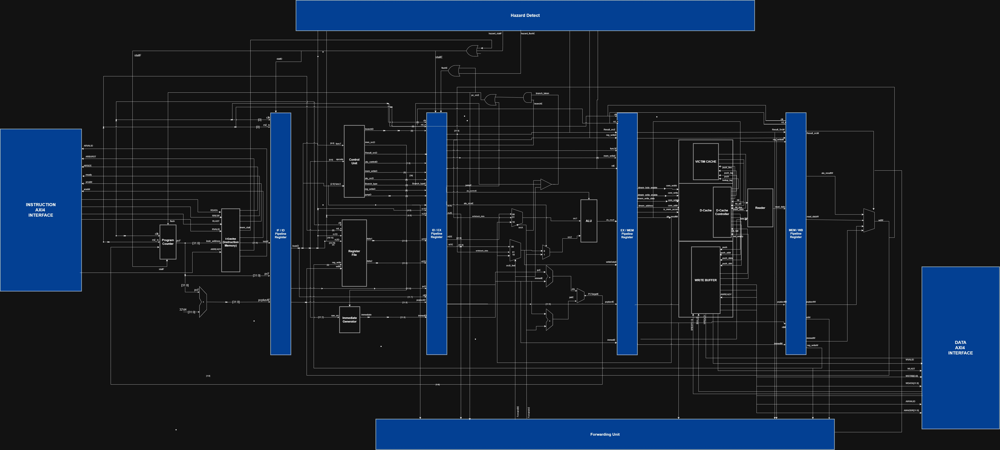
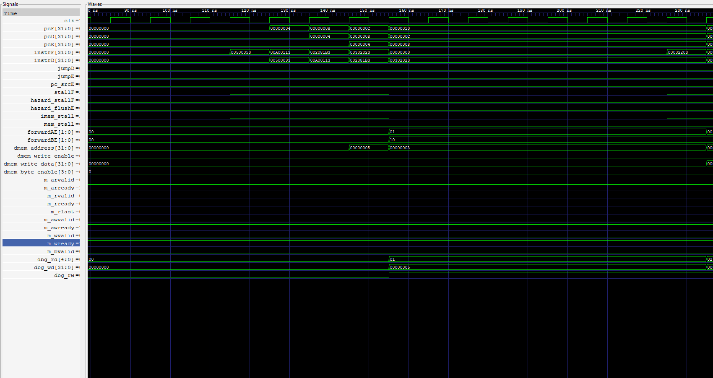
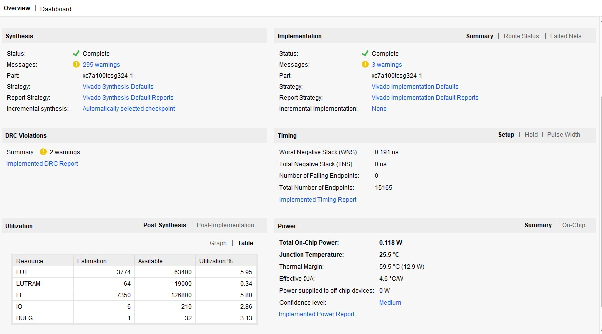
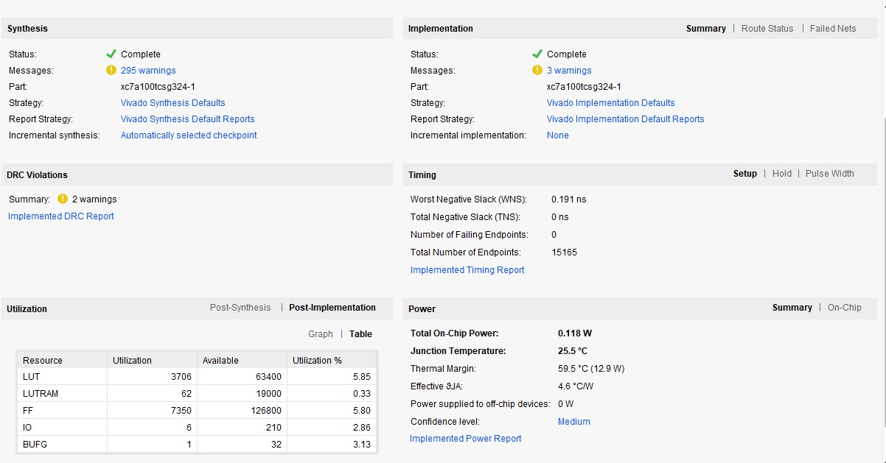

# RV32I CPU — from a single-cycle core to a pipelined processor

This repository documents my journey building a RISC-V processor in SystemVerilog: I began with a single-cycle CPU while learning computer-architecture fundamentals from the Harris & Harris computer-architecture book, then developed a more ambitious five-stage pipelined design with forwarding, hazard control, cache logic, AXI-style interfaces, simulation, and FPGA integration.

It is both a hardware project and a learning record. The code, diagrams, test material, simulation captures, and Vivado snapshots are organized here so someone can follow how the design grew and see what each piece demonstrates.

> **Choose the implementation deliberately:** the repository contains both an earlier CPU in `rtl/` and the pipelined CPU in `rtl_pipeline/`. Both declare a module named `cpu`; do not compile both variants together. The pipelined design is the main focus of the project showcase.

## What I built

- An earlier single-cycle CPU that helped me translate instruction formats, decode/control, register-file access, ALU operations, memory operations, and PC updates into RTL.
- A five-stage pipeline organized into **IF**, **ID**, **EX**, **MEM**, and **WB**, with pipeline registers between stages.
- Forwarding paths and hazard/stall/flush control to handle data dependencies, memory delays, and control-flow changes.
- A two-way I-cache and D-cache, with four 32-bit words per line in the RTL; the D-cache also instantiates a two-entry victim cache and a four-entry write buffer for write requests/writeback data.
- A board-level FPGA wrapper, constraints, and a recorded FPGA bring-up demonstration.
- Simulation and implementation evidence, with limitations documented alongside the results.

## How the design evolved

I started by making the basic processor work as a single-cycle datapath. That version gave me a reference point: an instruction is fetched, decoded, executed, and its result or memory effect is produced in one cycle. Working through that design made the path of the data and control signals concrete before I added pipeline timing.

From there, I split instruction processing across five stages. That changed the problem from “does each instruction do the right thing?” to also asking “what happens when several instructions are in flight together?” I added stage registers, forwarding selection, and hazard handling, then followed the PC and instruction stream through simulation to investigate stalls, redirects, and memory transactions. The included architecture drawing captures the intended system-level organization; the companion notes map it to the modules that are actually present.

The project’s development and test context is described in [Project journey](docs/project-journey.md), [Architecture notes](docs/architecture.md), and [Verification notes](docs/verification.md).

## Architecture



The drawing is intentionally a full system overview. Some labels describe logical functions inside a larger module rather than separately instantiated RTL modules. See [Architecture notes](docs/architecture.md) before treating every box as a distinct module boundary.

## Official RISC-V ISA verification

I ran the **official RISC-V ISA verification tests** as part of this project. This is a separate and important part of my verification work, alongside the project’s own directed programs and waveform debugging.

The pipeline ISA testbench is checked in at [`tb/ISA_TESTS/tb_isa.sv`](tb/ISA_TESTS/tb_isa.sv). It connects AXI BRAM memory models, loads a program with `+HEX`, loads expected register values with `+EXP`, records register writeback, and compares x1–x31 with the expected register file. This is the repo’s pipeline-level ISA test path.

I also ran the **official RISC-V ISA verification tests** as part of the project. The current repo does not include the official suite’s exact name/version, configuration, command, or a pass/fail transcript, so readers can see the testbench but cannot independently audit which official tests passed. The checked-in `tb/ISA_TESTS/test_rv32i_full.S` is a separate project-directed program—not the official suite—and covers shifts, JAL/JALR, and word/halfword/byte loads with signed and unsigned extension. See [Verification notes](docs/verification.md) for the distinction and current evidence.

## Directed pipeline simulation

The shared six-instruction smoke program is:

```text
00500093  addi x1, x0, 5
00a00113  addi x2, x0, 10
002081b3  add  x3, x1, x2
00302023  sw   x3, 0(x0)
00002203  lw   x4, 0(x0)
0000006f  jal  x0, 0
```

The expected results are x1=5, x2=10, x3=15, data memory word 0=15, and x4=15. The waveform images show the directed simulation activity around instruction flow, data dependencies, and memory operations. They are evidence for this program and setup, not an exhaustive RV32I compliance suite.

| Pipeline execution | Load/store activity |
|---|---|
|  |  |

The repository preserves test flows from multiple development stages. The single-cycle Cocotb harness under `tb/cpu/` checks selected register and memory values. The legacy `tb/ISA_TESTS/Makefile` also selects `rtl/cpu.sv`; it is not a pipeline build. The separate pipeline bench `tb/ISA_TESTS/tb_isa.sv` connects AXI BRAM models, records register writeback, and compares x1–x31 against an expected register file selected with `+EXP`. The six-word waveform run used a separate `tb_riscv.sv` and `my_test.hex`; those files are not yet in this repo, so that exact capture cannot be reproduced from a clean checkout. More detail is in [Verification notes](docs/verification.md).

## FPGA implementation snapshot

The supplied Vivado report screenshots identify target part **xc7a100tcsg324-1** and show:

- **Post-synthesis estimate:** 3,774 LUTs, 64 LUTRAMs, 7,350 flip-flops.
- **Post-implementation:** 3,706 LUTs, 62 LUTRAMs, 7,350 flip-flops, 6 I/Os, 1 BUFG.
- **Setup timing summary:** WNS +0.191 ns, TNS 0 ns, 0 failing endpoints.
- **Estimated on-chip power:** 0.118 W.

These are snapshots from the supplied Vivado project results. The checked-in `top.sv` ties instruction read data to NOP and D-cache read data to zero, so Vivado may have optimized away logic that would be active with real memories. Treat the utilization and timing as results for that particular wrapper/project snapshot, not as area/timing for a fully memory-connected processor. The captures also omit source revision, tool version, and full project settings.

| Post-synthesis | Post-implementation |
|---|---|
|  |  |

## FPGA bring-up

[View the FPGA demonstration video](docs/assets/fpga-demo.mp4).

The clip shows the Artix-7 board-level wrapper active, not the six-instruction program executing from hardware instruction memory. In the checked-in `top.sv`, instruction read data is tied to `32'h00000013` (NOP), D-cache read data is tied to zero, and the write path is connected to an AXI GPIO block. Functional program execution and ISA verification were performed in simulation.

## Repository guide

- `rtl/` — earlier CPU implementation and related RTL.
- `rtl_pipeline/` — pipelined CPU and supporting modules.
- `package/` — shared SystemVerilog package.
- `tb/` — testbenches and ISA test materials.
- `sim/` — simulator projects and historical run artifacts.
- `top.sv`, `mm.xdc` — FPGA wrapper and pin/clock constraints.
- `docs/` — project journey, architecture, verification notes, and media evidence.

## Project scope

This is an educational processor implementation. The directed program demonstrates a small set of instructions and selected pipeline/memory behavior. It is not a complete RV32I compliance claim, and the FPGA wrapper’s current tie-offs are documented above. The goal of this repository is to make the design, its development path, and its demonstrated evidence easy to inspect.
